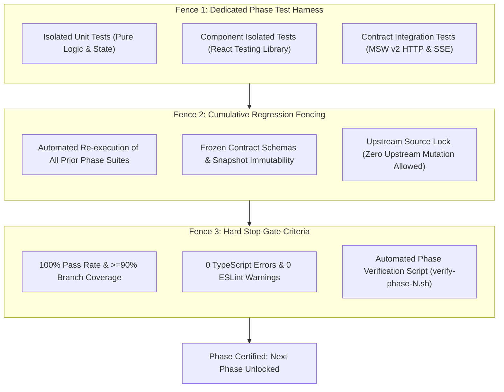
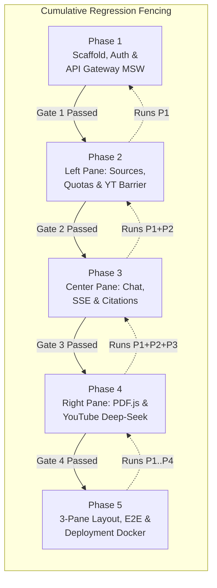

# StudyLM (KnowledgeLM) — Frontend & Deployment Architecture
## Phase-by-Phase Testing & Verification Specification

**Architectural Role**: Testing & Isolation Architect  
**Target Environment**: Next.js 15 (TypeScript, Tailwind CSS, shadcn/ui) + FastAPI Backend + Docker Deployment  
**Standard**: Strict Test-Driven Isolation, Zero Flakiness, Cumulative Regression Fencing  

---

## 1. Executive Strategy & Architectural Guardrails

### 1.1 The Testing Philosophy: The Triple-Fence Architecture
To ensure high-velocity, autonomous implementation across multiple agents without cross-phase regression or contract drift, StudyLM enforces the **Triple-Fence Architecture**:



1. **Dedicated Phase Test Harness**: Every phase provides its own deterministic test runners, mock services, and component test fixtures. No network calls touch external servers or staging environments during unit/component/contract tests.
2. **Cumulative Regression Fencing**: When working on Phase $N$, the agent's verification command executes all tests from Phase $1 \dots N$. If any test from Phase $1 \dots (N-1)$ breaks, the phase build immediately fails. Agents are forbidden from modifying upstream test expectations to pass downstream work.
3. **Hard Stop Gate Criteria**: A strict binary gate script (`pnpm test:gate:p<N>`) validates zero type errors, zero lint warnings, 100% test pass rate, and full coverage of edge cases before the subsequent phase can be touched.

### 1.2 Tech Stack & Test Infrastructure Inventory

| Layer | Technology | Primary Purpose | Test / Mocking Tooling |
| :--- | :--- | :--- | :--- |
| **Framework** | Next.js 15 (App Router, React 19) | Application runtime, layouts, routing | Vitest 2.x, `@vitejs/plugin-react` |
| **Component Testing** | `@testing-library/react`, `@testing-library/user-event` | User-centric DOM behavior simulation | jsdom / happy-dom, `@testing-library/jest-dom` |
| **Network & Contracts** | MSW v2 (Mock Service Worker) | Full API simulation (REST + SSE streaming) | `msw/node`, `ReadableStream`, `TextEncoder` |
| **State Management** | Zustand 5.x + TanStack Query v5 | Active notebook, active source, citation state | In-memory Zustand reset harness |
| **PDF Rendering** | `pdfjs-dist` (v4.x) | PDF Canvas, text layer, normalized overlays | Canvas 2D Mock, DOM SVG overlay harness |
| **Video Player** | YouTube IFrame API / `react-player` | Lecture video playback & deep seeking | Window `YT.Player` Mock Harness |
| **End-to-End** | Playwright Test | Full user journeys in headless Chromium | Headless browser + Dockerized backend |
| **Deployment** | Docker Standalone + Vercel / Railway | Production hosting parity | Docker Compose, curl health probes, Trivy |

---

## 2. Phase-by-Phase Execution & Gate Matrix



### Summary of Phases
- **Phase 1**: Project Scaffolding, Design Tokens, Google OAuth / Session State, and MSW v2 API Gateway Contract Layer.
- **Phase 2**: Left Pane — Notebook Switcher, Source Management, 50MB/20-Source Quotas, and Two-Tier YouTube Moderation Barrier UI.
- **Phase 3**: Center Pane — Conversational Chat Workspace, SSE Streaming Event Parser, Sentence-Buffered Markdown Renderer, and Citation Pill Interactions.
- **Phase 4**: Right Pane — Multimodal Deep-Link Inspector (Rotation-Proof Relative Bounding Box PDF.js Viewer & YouTube Auto-Seek Player).
- **Phase 5**: 3-Pane Composite Workspace Integration, Playwright End-to-End Test Suite, and Production Deployment Hardening.

---

## 3. Phase 1: Scaffolding, Auth, Session State & MSW Contract Layer

### 3.1 Scope & Objective
Establish the Next.js 15 project foundations, Tailwind CSS / shadcn/ui design tokens, Google OAuth 2.0 / NextAuth session management, API client with interceptors, and the complete Mock Service Worker (MSW v2) baseline contract harness simulating all backend REST endpoints and error scenarios.

### 3.2 Dedicated Test Harness Configuration
- **Test Runner**: Vitest (`vitest.config.ts`) configured with `environment: 'jsdom'`.
- **Mocking Framework**: MSW v2 (`msw/node`).
- **Global Setup**: `tests/setup.ts` installing MSW server interceptors, mocking `next/navigation`, and polyfilling `ResizeObserver` and `crypto.randomUUID`.
- **Target Directories**: `src/lib/api/`, `src/lib/auth/`, `src/stores/`, `tests/phase1/`.

### 3.3 Strict Gate Criteria (Gate 1)
To unlock Phase 2, the agent must fulfill 100% of the following checklist:
- [ ] `pnpm tsc --noEmit` exits with code 0 (zero TypeScript errors).
- [ ] `pnpm lint` exits with code 0 (zero ESLint warnings/errors).
- [ ] All Phase 1 tests (`tests/phase1/**/*.test.ts(x)`) pass cleanly in Vitest.
- [ ] MSW handlers fully model all 12 backend routes with both success and failure contracts (200, 206, 400, 401, 403, 404, 409, 413, 429, 500).
- [ ] Automated verification script exits cleanly: `pnpm run verify:p1`.

### 3.4 Test Suite Inventory

| File Path | Test Suite | Test Cases & Scenarios | Mocking / Verification Strategy |
| :--- | :--- | :--- | :--- |
| `tests/phase1/test_auth_session.test.ts` | Auth & Session Management | 1. `test_google_oauth_session_initialization`: Authenticated user loads session profile, avatar, and JWT token.<br/>2. `test_unauthenticated_session_redirects_to_login`: Accessing `/workspace` without token redirects to `/login`.<br/>3. `test_expired_jwt_triggers_token_refresh_or_logout`: Expired JWT (401) clears auth store and triggers re-auth.<br/>4. `test_deactivated_user_displays_403_banner`: API response 403 ("Account pending deletion") displays hard account lock modal. | Mock `next-auth/react` hooks (`useSession`, `signIn`, `signOut`). |
| `tests/phase1/test_api_client_contracts.test.ts` | API Client & Error Interceptors | 1. `test_bearer_token_injected_in_all_api_requests`: Client automatically appends `Authorization: Bearer <jwt>`.<br/>2. `test_anti_enumeration_404_handling`: Client handles 404 cleanly without revealing resource existence.<br/>3. `test_conflict_409_handling`: Handling deletion conflict returns structured domain error.<br/>4. `test_rate_limit_429_interceptor`: 429 response dispatches global `RATE_LIMIT_TRIGGERED` event with retry-after header. | MSW v2 server intercepting `fetch` calls, validating headers and status code translation. |
| `tests/phase1/test_notebook_store.test.ts` | Notebook & Tenant State Store | 1. `test_active_notebook_persistence`: Selecting notebook persists ID in localStorage and Zustand store.<br/>2. `test_last_active_notebook_restoration`: On page load, `last_active_notebook_id` from user profile is restored.<br/>3. `test_cross_tenant_state_purge`: Logging out or switching users immediately wipes loaded notebooks/sources. | In-memory Zustand store test harness with localStorage mock. |
| `tests/phase1/test_design_tokens.test.tsx` | Design Tokens & Theme | 1. `test_theme_tokens_contrast_ratios`: Primary/secondary text and background satisfy WCAG AAA (7:1).<br/>2. `test_error_banner_token_styling`: Warning banner classes match amber-500/red-500 semantic tokens. | RTL component render testing DOM class names and computed styles. |

### 3.5 Automated Test Harness Implementation Example
```typescript
// tests/phase1/test_api_client_contracts.test.ts
import { describe, it, expect, beforeAll, afterAll, afterEach } from 'vitest';
import { setupServer } from 'msw/node';
import { http, HttpResponse } from 'msw';
import { apiClient } from '@/lib/api/client';
import { useAuthStore } from '@/stores/authStore';

const server = setupServer(
  http.get('/api/notebooks/:id', ({ request, params }) => {
    const auth = request.headers.get('Authorization');
    if (!auth || !auth.includes('valid-jwt')) {
      return new HttpResponse(null, { status: 401 });
    }
    if (params.id === 'unauthorized-nb') {
      // Backend returns 404 for unauthorized notebooks (anti-enumeration)
      return new HttpResponse(null, { status: 404 });
    }
    return HttpResponse.json({ id: params.id, title: 'Bio 101', status: 'active' });
  })
);

beforeAll(() => server.listen());
afterEach(() => {
  server.resetHandlers();
  useAuthStore.getState().reset();
});
afterAll(() => server.close());

describe('API Client Contracts', () => {
  it('test_bearer_token_injected_in_all_api_requests', async () => {
    useAuthStore.getState().setToken('valid-jwt');
    const res = await apiClient.getNotebook('valid-nb');
    expect(res.id).toBe('valid-nb');
  });

  it('test_anti_enumeration_404_handling', async () => {
    useAuthStore.getState().setToken('valid-jwt');
    await expect(apiClient.getNotebook('unauthorized-nb')).rejects.toThrow('Resource not found');
  });
});
```

---

## 4. Phase 2: Left Pane — Notebooks, Source Center & YouTube Moderation Barrier UI

### 4.1 Scope & Objective
Implement the Left Sidebar: notebook switcher, source management list, upload modal/drag-and-drop zone, quota locks (50MB file size & 20 sources/user limit), source status states (`processing`, `ready`, `deleting`, `reindexing`, `error`), and the complete UI for the **Two-Tier YouTube Moderation Barrier**.

### 4.2 Dedicated Test Harness Configuration
- **Test Runner**: Vitest (`tests/phase2/`).
- **Mocking Framework**: MSW v2 multipart upload handlers, custom error code factories (`ERR_NON_EDUCATIONAL_CONTENT`, `ERR_CORRUPT_FILE`, `ERR_YT_NO_TRANSCRIPT`).
- **File Upload Simulator**: Custom `File` / `Blob` generators with byte-size spoofing.

### 4.3 Strict Gate Criteria (Gate 2)
To unlock Phase 3, the agent must fulfill 100% of the following checklist:
- [ ] **Regression Fence Green**: All Phase 1 tests pass (`pnpm test:phase1`).
- [ ] All Phase 2 tests (`tests/phase2/**/*.test.ts(x)`) pass cleanly.
- [ ] Exact warning message verified: `Upload educational related video, this video does not have educational content please recheck the link`.
- [ ] Title suppression verified: non-educational YouTube video titles render as `[Suppressed: Non-Educational Content]`.
- [ ] 20-source quota lock verified: 21st source upload is disabled in UI and rejected with quota warning.
- [ ] 50MB file size guard verified: files $>50\text{MB}$ are blocked client-side with pre-flight error before upload.
- [ ] Automated verification script exits cleanly: `pnpm run verify:p2`.

### 4.4 Test Suite Inventory

| File Path | Test Suite | Test Cases & Scenarios | Mocking / Verification Strategy |
| :--- | :--- | :--- | :--- |
| `tests/phase2/test_youtube_moderation_ui.test.tsx` | Educational Barrier UI | 1. `test_non_educational_youtube_displays_exact_warning_banner`: Submitting entertainment URL displays banner: `⚠️ Upload educational related video, this video does not have educational content please recheck the link`.<br/>2. `test_non_educational_youtube_suppresses_title_and_transcript`: Source card renders title as `[Suppressed: Non-Educational Content]`, summary is hidden, and no inspect button is rendered.<br/>3. `test_valid_educational_youtube_ingestion_renders_ready`: Valid MIT lecture URL returns `status="ready"` with duration and video thumbnail. | MSW v2 returning `status: "error"`, `error_code: "ERR_NON_EDUCATIONAL_CONTENT"`, `error_message: "Upload educational related video, this video does not have educational content please recheck the link"`. |
| `tests/phase2/test_upload_and_quota_guards.test.tsx` | Upload Guard & Quota UI | 1. `test_client_blocks_upload_exceeding_50mb`: Selecting a 51MB PDF file rejects immediately with "File exceeds 50MB limit" without firing network request.<br/>2. `test_twenty_source_quota_locks_upload_ui`: When notebook has 20 sources, "Upload Source" button is disabled with tooltip "Maximum 20 sources reached".<br/>3. `test_backend_400_quota_error_renders_quota_toast`: If server returns 400 Quota Exceeded, UI displays quota warning banner.<br/>4. `test_drag_and_drop_pdf_upload_progress`: Simulates drag-and-drop file upload with progress bar. | Simulated `File` objects of size `51 * 1024 * 1024` and MSW responses with 20 existing sources. |
| `tests/phase2/test_source_status_badges.test.tsx` | Source Lifecycle & Badges | 1. `test_processing_source_shows_pulsing_indicator`: `status="processing"` displays animated spinner/skeleton.<br/>2. `test_reindexing_badge_displays_secondary_badge`: `status="ready"` and `reindexing=true` shows "Re-indexing..." badge while maintaining open actions.<br/>3. `test_deleting_source_is_disabled`: `status="deleting"` grays out source card and disables all click actions.<br/>4. `test_corrupt_file_renders_error_badge`: `status="error"` with `ERR_CORRUPT_FILE` renders red error tag with tooltip. | RTL component rendering with state fixtures for all 5 lifecycle states. |
| `tests/phase2/test_cascading_deletion_ui.test.tsx` | Deletion Races & Confirmation | 1. `test_delete_source_requires_confirmation`: Clicking delete icon triggers confirm dialog before calling API.<br/>2. `test_source_delete_optimistic_update`: Confirming delete marks card as deleting immediately.<br/>3. `test_notebook_deletion_cascade_warning`: Deleting notebook warns about cascading deletion of all sources. | MSW v2 `DELETE /api/sources/:id` and `DELETE /api/notebooks/:id`. |

### 4.5 Component Test Verification Example: YouTube Barrier UI
```tsx
// tests/phase2/test_youtube_moderation_ui.test.tsx
import { render, screen, waitFor } from '@testing-library/react';
import userEvent from '@testing-library/user-event';
import { SourceList } from '@/components/workspace/SourceList';
import { setupServer } from 'msw/node';
import { http, HttpResponse } from 'msw';

const server = setupServer(
  http.post('/api/notebooks/nb-1/sources', async () => {
    return HttpResponse.json({
      id: 'src-rejected',
      title: '[Suppressed: Non-Educational Content]',
      source_type: 'youtube',
      status: 'error',
      error_code: 'ERR_NON_EDUCATIONAL_CONTENT',
      error_message: 'Upload educational related video, this video does not have educational content please recheck the link',
    }, { status: 200 });
  })
);

describe('YouTube Educational Moderation Barrier UI', () => {
  it('test_non_educational_youtube_displays_exact_warning_banner', async () => {
    render(<SourceList notebookId="nb-1" />);
    
    // Simulate submitting non-educational URL
    const input = screen.getByPlaceholderText(/Enter YouTube URL/i);
    const submitBtn = screen.getByRole('button', { name: /Add Source/i });
    
    await userEvent.type(input, 'https://www.youtube.com/watch?v=entertainment123');
    await userEvent.click(submitBtn);

    await waitFor(() => {
      // Must display exact verbatim warning text
      expect(screen.getByText(/Upload educational related video, this video does not have educational content please recheck the link/i)).toBeInTheDocument();
      // Must suppress title
      expect(screen.getByText('[Suppressed: Non-Educational Content]')).toBeInTheDocument();
      // Must NOT render video thumbnail or transcript button
      expect(screen.queryByRole('button', { name: /View Transcript/i })).not.toBeInTheDocument();
    });
  });
});
```

---

## 5. Phase 3: Center Pane — Chat Workspace, SSE Streaming & Citations

### 5.1 Scope & Objective
Implement the Center Pane: message thread, prompt input box, Server-Sent Events (SSE) streaming engine, sentence-buffered markdown rendering, interactive citation pills (`[[cite:1]]` / `[1]`), unverified citation warnings (`[Citation Unverified]`), refusal state handling ("Insufficient context in notes"), and hourly chat rate limit (60 queries/hr) UI indicators.

### 5.2 Dedicated Test Harness Configuration
- **Test Runner**: Vitest (`tests/phase3/`).
- **SSE Stream Engine Simulator**: Custom MSW v2 SSE handler utilizing `ReadableStream` and `TextEncoder` emitting realistic event chunks (`event: token`, `event: citation`, `event: refusal`, `event: done`, `event: error`).
- **Markdown AST Inspector**: Verify citation token nodes replace raw text without breaking KaTeX math or code blocks.

### 5.3 Strict Gate Criteria (Gate 3)
To unlock Phase 4, the agent must fulfill 100% of the following checklist:
- [ ] **Regression Fence Green**: All Phase 1 + Phase 2 tests pass (`pnpm test:phase1 && pnpm test:phase2`).
- [ ] All Phase 3 tests (`tests/phase3/**/*.test.ts(x)`) pass cleanly.
- [ ] SSE parser cleanly handles fragmented chunk boundaries without dropping tokens.
- [ ] Citation pills render with authoritative source titles, page numbers, and quote hovercards.
- [ ] Unverified citations (`[Citation Unverified]`) render with subtle alert styling and do not crash the UI.
- [ ] Calibrated refusal responses display polite context limitation notice.
- [ ] 60 queries/hr rate limit error (429) displays countdown timer / rate limit notice.
- [ ] Mid-stream connection drop or 401 token expiration halts stream with error toast.
- [ ] Automated verification script exits cleanly: `pnpm run verify:p3`.

### 5.4 Test Suite Inventory

| File Path | Test Suite | Test Cases & Scenarios | Mocking / Verification Strategy |
| :--- | :--- | :--- | :--- |
| `tests/phase3/test_sse_stream_parser.test.ts` | SSE Stream Engine | 1. `test_sse_parses_token_stream_incrementally`: Parser emits tokens sequentially as chunks arrive.<br/>2. `test_sse_handles_fragmented_packet_boundaries`: Packets split across arbitrary byte boundaries (e.g., `data: {"to` ... `ken": "foo"}`) are assembled cleanly.<br/>3. `test_sse_resolves_citations_on_done`: Parser parses `citation` events and links metadata to marker IDs.<br/>4. `test_sse_handles_server_error_event`: Server emitting `event: error` triggers error state and stops reader.<br/>5. `test_sse_mid_stream_token_expiry_401`: HTTP 401 mid-stream triggers immediate stream abort and auth alert. | Custom `ReadableStream` controller in MSW simulating chunk delays and fragmented packets. |
| `tests/phase3/test_sentence_buffered_markdown.test.tsx` | Markdown & Citations | 1. `test_markdown_replaces_cite_tokens_with_interactive_pills`: Text `Newton's second law [[cite:1]].` renders interactive badge `[1]`.<br/>2. `test_unverified_citation_renders_warning_tag`: Markdown with `[Citation Unverified]` renders warning badge with tooltip "Citation not found in source notes".<br/>3. `test_citation_pill_hovercard_displays_payload_quote`: Hovering `[1]` opens card showing source title, page number, and authoritative quote.<br/>4. `test_citation_pill_click_dispatches_sync_event`: Clicking `[1]` dispatches global `SELECT_CITATION` event with target source, page, and bboxes. | RTL rendering of `GroundedMarkdown` component with citation metadata dictionary. |
| `tests/phase3/test_chat_refusal_and_rate_limit.test.tsx` | Refusal & Rate Limits | 1. `test_calibrated_refusal_renders_clear_notice`: Server refusal response displays banner "I don't have enough information in your notes to answer that."<br/>2. `test_rate_limit_429_disables_chat_input`: HTTP 429 response disables send button and displays "Hourly rate limit reached (60 queries/hr)".<br/>3. `test_retry_after_timer_countdown`: Rate limit card updates countdown timer every second. | MSW handler returning `refusal: true` and HTTP 429 with `Retry-After: 3600`. |
| `tests/phase3/test_chat_input_and_history.test.tsx` | Chat Thread UI | 1. `test_submitting_query_appends_user_bubble_immediately`: Query immediately appears in chat with pending status.<br/>2. `test_chat_history_restoration_on_notebook_select`: Selecting notebook loads historical messages with citations.<br/>3. `test_summarize_source_shortcut_triggers_summary_flow`: Clicking "Summarize Document" dispatches summarization intent. | In-memory message store and MSW `GET /api/notebooks/:id/messages`. |

### 5.5 SSE Streaming Test Harness Example
```typescript
// tests/phase3/test_sse_stream_parser.test.ts
import { describe, it, expect } from 'vitest';
import { parseSseStream } from '@/lib/api/sseStream';

describe('SSE Stream Parser Unit Tests', () => {
  it('test_sse_handles_fragmented_packet_boundaries', async () => {
    // Simulate fragmented chunks: split in middle of JSON payload
    const chunks = [
      'event: token\ndata: {"content": "Force eq',
      'uals mass "}\n\nevent: token\ndata: {"content": "times acceleration [[cite:1]]."}\n\n',
      'event: citation\ndata: {"marker_id": 1, "source_id": "src-1", "source_title": "Physics", "page_number": 42, "quote": "F=ma"}\n\n',
      'event: done\ndata: {}\n\n'
    ];

    const stream = new ReadableStream({
      start(controller) {
        for (const chunk of chunks) {
          controller.enqueue(new TextEncoder().encode(chunk));
        }
        controller.close();
      }
    });

    const receivedTokens: string[] = [];
    const receivedCitations: any[] = [];

    await parseSseStream(stream, {
      onToken: (token) => receivedTokens.push(token),
      onCitation: (cite) => receivedCitations.push(cite),
    });

    expect(receivedTokens.join('')).toBe('Force equals mass times acceleration [[cite:1]].');
    expect(receivedCitations).toHaveLength(1);
    expect(receivedCitations[0].source_title).toBe('Physics');
    expect(receivedCitations[0].page_number).toBe(42);
  });
});
```

---

## 6. Phase 4: Right Pane — Multimodal Deep-Link Inspector (PDF.js & YouTube)

### 6.1 Scope & Objective
Implement the Right Pane: dual-mode multimodal inspector supporting both high-fidelity PDF rendering with rotation-proof bounding box overlays and YouTube video playback with auto-seek precision. Validate bidirectional event communication between citation clicks in chat and navigation in the inspector.

### 6.2 Dedicated Test Harness Configuration
- **Test Runner**: Vitest (`tests/phase4/`).
- **DOM Canvas Mock**: Mock HTML5 Canvas 2D context for PDF.js page rendering (`jest-canvas-mock`).
- **Coordinate Engine Unit Suite**: Strict mathematical assertions verifying coordinate transformation from relative float $[0.0, 1.0]$ space to viewport pixel rectangles across all 4 rotation states ($0^\circ, 90^\circ, 180^\circ, 270^\circ$).
- **YouTube API Mock**: Window `YT.Player` mock inspecting `seekTo(seconds, allowSeekAhead)` calls.

### 6.3 Strict Gate Criteria (Gate 4)
To unlock Phase 5, the agent must fulfill 100% of the following checklist:
- [ ] **Regression Fence Green**: All Phase 1, Phase 2, and Phase 3 tests pass (`pnpm test:phase1 && pnpm test:phase2 && pnpm test:phase3`).
- [ ] All Phase 4 tests (`tests/phase4/**/*.test.ts(x)`) pass cleanly.
- [ ] Coordinate conversion math mathematically proven across 0°, 90°, 180°, and 270° rotations.
- [ ] Multi-line bounding boxes (`bboxes: List[List[float]]`) render multiple distinct highlight rectangles without overlapping or visual clipping.
- [ ] Scanned page fallback: when `bboxes` is empty (`[]`), page-level amber alert highlight is rendered.
- [ ] Citation click in chat automatically scrolls PDF to `page_number` and triggers highlight pulse.
- [ ] YouTube player seek executes `seekTo(start_seconds, true)` and updates timestamp indicator.
- [ ] Automated verification script exits cleanly: `pnpm run verify:p4`.

### 6.4 Test Suite Inventory

| File Path | Test Suite | Test Cases & Scenarios | Mocking / Verification Strategy |
| :--- | :--- | :--- | :--- |
| `tests/phase4/test_pdf_coordinate_transform.test.ts` | PDF Coordinate Engine | 1. `test_transform_box_zero_rotation`: Bounding box `[0.1, 0.2, 0.5, 0.4]` at $0^\circ$ remains `[0.1, 0.2, 0.5, 0.4]`.<br/>2. `test_transform_box_90_degree_rotation`: Rotation $90^\circ$ maps `[x0, y0, x1, y1]` to `[1 - y1, x0, 1 - y0, x1]`.<br/>3. `test_transform_box_180_degree_rotation`: Rotation $180^\circ$ maps to `[1 - x1, 1 - y1, 1 - x0, 1 - y0]`.<br/>4. `test_transform_box_270_degree_rotation`: Rotation $270^\circ$ maps to `[y0, 1 - x1, y1, 1 - x0]`.<br/>5. `test_percentage_to_pixel_viewport_mapping`: Normalized coordinates scaled to $800 \times 1200$ viewport produce exact pixel coordinates. | Pure unit math test suite with parameterized test matrix covering all rotation angles and boundary edges ($0.0, 1.0$). |
| `tests/phase4/test_pdf_highlight_overlay.test.tsx` | PDF Highlight Layer | 1. `test_multiline_sentence_renders_multiple_highlight_rectangles`: Sentence with 3 line bboxes renders exactly 3 `div.pdf-highlight` elements.<br/>2. `test_active_citation_scrolls_target_page_into_view`: Emitting citation event for page 15 scrolls page 15 into view.<br/>3. `test_scanned_page_empty_bboxes_renders_page_banner`: Citation with `bboxes: []` renders top-of-page highlight banner: "Highlighted quote located on this scanned page".<br/>4. `test_authenticated_range_stream_headers`: PDF viewer requests `/sources/:id/stream` with `Range: bytes=0-` headers. | RTL render with mock PDF.js container, inspecting overlay DOM coordinates and CSS styles. |
| `tests/phase4/test_youtube_seek_player.test.tsx` | YouTube Deep-Seek | 1. `test_youtube_player_initialization_with_url`: Player embeds video ID parsed from watch URL or short URL.<br/>2. `test_citation_click_triggers_player_seek`: Disagreeing citation with `start_seconds=1394` calls `player.seekTo(1394, true)`.<br/>3. `test_timestamp_badge_formatting`: `start_seconds=1394` renders as `23:14` in citation pill and inspector header. | Mock `YT.Player` instance tracking method invocations and state change callbacks. |
| `tests/phase4/test_multimodal_tab_switcher.test.tsx` | Inspector Switcher | 1. `test_switching_from_pdf_to_youtube_citation_updates_view`: Clicking YouTube citation automatically switches right pane from PDF to YouTube player.<br/>2. `test_retaining_last_inspected_state_per_source`: Switching back to PDF preserves page scroll position. | RTL component integration testing parent inspector state. |

### 6.5 PDF Coordinate Engine Test Implementation Example
```typescript
// tests/phase4/test_pdf_coordinate_transform.test.ts
import { describe, it, expect } from 'vitest';
import { transformBox, calculatePixelRect } from '@/components/workspace/pdf/coordinateMath';

describe('PDF.js Coordinate Transformation Engine', () => {
  const box = [0.1, 0.2, 0.6, 0.5]; // [x0, y0, x1, y1]

  it('test_transform_box_zero_rotation', () => {
    expect(transformBox(box, 0)).toEqual([0.1, 0.2, 0.6, 0.5]);
  });

  it('test_transform_box_90_degree_rotation', () => {
    // 90 deg: [1 - y1, x0, 1 - y0, x1]
    // 1 - 0.5 = 0.5; x0 = 0.1; 1 - 0.2 = 0.8; x1 = 0.6
    expect(transformBox(box, 90)).toEqual([0.5, 0.1, 0.8, 0.6]);
  });

  it('test_transform_box_180_degree_rotation', () => {
    // 180 deg: [1 - x1, 1 - y1, 1 - x0, 1 - y0]
    expect(transformBox(box, 180)).toEqual([0.4, 0.5, 0.9, 0.8]);
  });

  it('test_transform_box_270_degree_rotation', () => {
    // 270 deg: [y0, 1 - x1, y1, 1 - x0]
    expect(transformBox(box, 270)).toEqual([0.2, 0.4, 0.5, 0.9]);
  });

  it('test_percentage_to_pixel_viewport_mapping', () => {
    const viewport = { width: 1000, height: 2000 };
    const pixelRect = calculatePixelRect(box, viewport);
    expect(pixelRect).toEqual({
      left: 100, // 0.1 * 1000
      top: 400,  // 0.2 * 2000
      width: 500,// (0.6 - 0.1) * 1000
      height: 600// (0.5 - 0.2) * 2000
    });
  });
});
```

---

## 7. Phase 5: 3-Pane Composite Workspace, Playwright E2E & Deployment

### 7.1 Scope & Objective
Unify the Left, Center, and Right Panes into the complete responsive 3-pane StudyLM workspace (`react-resizable-panels`), implement end-to-end user journeys using Playwright, containerize the frontend and backend, and verify production deployment health.

### 7.2 Dedicated Test Harness Configuration
- **Component Harness**: Vitest + RTL for composite layout, resizer persistence, and keyboard navigation.
- **E2E Test Runner**: Playwright (`playwright.config.ts`) running against containerized or local full-stack server.
- **Deployment Verifier**: Docker Compose testing Next.js Standalone container, Fastify/FastAPI API container, Postgres, and Qdrant.

### 7.3 Strict Gate Criteria (Gate 5 - Final Certification)
To certify StudyLM frontend and deployment for production readiness:
- [ ] **Full Regression Suite Green**: All unit and component tests from Phases 1, 2, 3, and 4 pass (`pnpm test:all`).
- [ ] **Playwright E2E Suite Green**: 100% pass across all 6 critical user journeys (`tests/e2e/**/*.spec.ts`).
- [ ] **Zero Cross-Tenant Leakage**: E2E verifies User B cannot view User A's notebooks, sources, or citations.
- [ ] **Educational Moderation Barrier E2E**: Submitting entertainment YouTube URL renders exact warning banner and produces zero inspectable data.
- [ ] **Docker Production Build**: Frontend Dockerfile compiles cleanly (`standalone` output) with zero build errors.
- [ ] **Security & CSP Audit**: CSP headers allow YouTube iframes, R2 presigned URLs, and SSE streams while blocking inline injection scripts.
- [ ] Automated verification script exits cleanly: `pnpm run verify:p5`.

### 7.4 Test Suite Inventory

| File Path | Test Suite | Test Cases & Scenarios | Mocking / Verification Strategy |
| :--- | :--- | :--- | :--- |
| `tests/phase5/test_composite_workspace_layout.test.tsx` | 3-Pane Workspace UI | 1. `test_resizable_pane_drag_persists_widths`: Dragging pane dividers updates and persists layout sizes.<br/>2. `test_mobile_drawer_collapses_left_and_right_panes`: Screen width $<768\text{px}$ collapses side panes into slide-over drawers.<br/>3. `test_keyboard_shortcuts_panel_toggle`: `Cmd+B` toggles left pane; `Cmd+J` toggles right inspector. | RTL render of `WorkspaceLayout` with mock `react-resizable-panels`. |
| `tests/e2e/e2e_full_student_journey.spec.ts` | Playwright E2E | 1. `test_e2e_student_complete_rag_journey`: Log in -> create notebook -> upload lecture PDF -> wait for ready -> ask question -> verify streaming text -> click citation [1] -> assert PDF scrolled to page 42 with yellow highlight box visible. | Real browser automated test in Chromium headless. |
| `tests/e2e/e2e_youtube_moderation_barrier.spec.ts` | Playwright E2E | 1. `test_e2e_entertainment_video_rejection`: Submit music video link -> assert banner `⚠️ Upload educational related video...` appears -> assert title masked -> assert right inspector remains closed. | Playwright interaction testing live frontend + backend barrier. |
| `tests/e2e/e2e_cross_tenant_isolation.spec.ts` | Playwright E2E | 1. `test_e2e_cross_tenant_url_tampering`: User B directly navigates to `/workspace?notebookId=<user_a_nb>` -> assert 404 page rendered -> zero data exposed. | Playwright multi-context authentication testing 2 isolated users. |
| `tests/phase5/test_deployment_docker_parity.test.ts` | Deployment & Health | 1. `test_frontend_standalone_docker_healthcheck`: Standalone container serves `/api/health` with HTTP 200.<br/>2. `test_csp_and_security_headers`: Asserts `Content-Security-Policy`, `X-Frame-Options`, `X-Content-Type-Options` match hardened spec. | Integration probe script curling Docker container ports. |

### 7.5 Playwright E2E Critical Journey Example
```typescript
// tests/e2e/e2e_full_student_journey.spec.ts
import { test, expect } from '@playwright/test';

test.describe('StudyLM Full Student Knowledge Journey', () => {
  test('test_e2e_student_complete_rag_journey', async ({ page }) => {
    // 1. Auth & Notebook Creation
    await page.goto('/login');
    await page.click('button:has-text("Sign in with Google")');
    await expect(page).toHaveURL(/\/workspace/);

    await page.click('button:has-text("New Notebook")');
    await page.fill('input[placeholder="Untitled Notebook"]', 'Physics 101');
    await page.press('input[placeholder="Untitled Notebook"]', 'Enter');

    // 2. Upload Lecture PDF
    const fileChooserPromise = page.waitForEvent('filechooser');
    await page.click('button:has-text("Upload Source")');
    const fileChooser = await fileChooserPromise;
    await fileChooser.setFiles('tests/fixtures/lecture_mechanics.pdf');

    // 3. Wait for Ingestion Ready
    await expect(page.locator('.source-card:has-text("lecture_mechanics.pdf")')).toContainText('ready', { timeout: 15000 });

    // 4. Submit Grounded Chat Query
    await page.fill('textarea[placeholder="Ask a question about your notes..."]', "What is Newton's second law?");
    await page.press('textarea[placeholder="Ask a question about your notes..."]', 'Enter');

    // 5. Verify Streaming & Citation Pill
    const citationPill = page.locator('button.citation-pill:has-text("[1]")');
    await expect(citationPill).toBeVisible({ timeout: 10000 });

    // 6. Click Citation & Assert PDF Page Navigation & Highlight
    await citationPill.click();

    // Verify right pane PDF viewer navigated to page 42
    await expect(page.locator('.pdf-page-number-indicator')).toHaveText('Page 42');

    // Verify bounding box highlight overlay is active and visible
    const highlightBox = page.locator('.pdf-highlight-overlay.active');
    await expect(highlightBox).toBeVisible();
    await expect(highlightBox).toHaveCSS('background-color', /rgba\(250,\s*204,\s*21/); // amber glow
  });
});
```

---

## 8. Master Test Runner & Regression Fencing Engine

### 8.1 Package Scripts Architecture (`package.json`)
The regression fencing engine is enforced through cumulative npm/pnpm scripts. Downstream phases are physically incapable of running in isolation without passing all upstream tests:

```json
{
  "scripts": {
    "test:phase1": "vitest run tests/phase1",
    "test:phase2": "pnpm test:phase1 && vitest run tests/phase2",
    "test:phase3": "pnpm test:phase2 && vitest run tests/phase3",
    "test:phase4": "pnpm test:phase3 && vitest run tests/phase4",
    "test:phase5": "pnpm test:phase4 && vitest run tests/phase5",
    "test:all": "vitest run tests/phase1 tests/phase2 tests/phase3 tests/phase4 tests/phase5",
    "test:e2e": "playwright test",
    "verify:p1": "tsc --noEmit && eslint . && pnpm test:phase1",
    "verify:p2": "tsc --noEmit && eslint . && pnpm test:phase2",
    "verify:p3": "tsc --noEmit && eslint . && pnpm test:phase3",
    "verify:p4": "tsc --noEmit && eslint . && pnpm test:phase4",
    "verify:p5": "tsc --noEmit && eslint . && pnpm test:phase5 && pnpm test:e2e",
    "verify:all": "pnpm verify:p5"
  }
}
```

### 8.2 Automated Phase Verification Gate Script (`scripts/verify-phase.sh`)
```bash
#!/usr/bin/env bash
set -euo pipefail

PHASE=${1:-"all"}

echo "=========================================================="
echo "  Executing Verification Gate for Phase: ${PHASE}"
echo "=========================================================="

echo "[1/4] Running Strict TypeScript Compilation..."
pnpm tsc --noEmit

echo "[2/4] Running ESLint Code Quality Inspection..."
pnpm eslint . --max-warnings 0

echo "[3/4] Executing Cumulative Test Suite (Regression Fenced)..."
case $PHASE in
  1) pnpm test:phase1 ;;
  2) pnpm test:phase2 ;;
  3) pnpm test:phase3 ;;
  4) pnpm test:phase4 ;;
  5) pnpm test:phase5 ;;
  all) pnpm test:all && pnpm test:e2e ;;
  *) echo "Unknown phase: ${PHASE}"; exit 1 ;;
esac

echo "=========================================================="
echo "  >>> GATE PASSED: Phase ${PHASE} Certified 100% Green <<<"
echo "=========================================================="
```

---

## 9. CI/CD Deployment Verification Pipeline

```yaml
name: StudyLM Frontend & Deployment Verification Pipeline

on:
  push:
    branches: [ main, develop ]
  pull_request:
    branches: [ main ]

jobs:
  typecheck-and-lint:
    runs-on: ubuntu-latest
    steps:
      - uses: actions/checkout@v4
      - uses: pnpm/action-setup@v3
        with:
          version: 9
      - uses: actions/setup-node@v4
        with:
          node-version: 20
          cache: 'pnpm'
      - run: pnpm install --frozen-lockfile
      - run: pnpm tsc --noEmit
      - run: pnpm eslint . --max-warnings 0

  unit-and-contract-tests:
    needs: typecheck-and-lint
    runs-on: ubuntu-latest
    steps:
      - uses: actions/checkout@v4
      - uses: pnpm/action-setup@v3
        with:
          version: 9
      - uses: actions/setup-node@v4
        with:
          node-version: 20
          cache: 'pnpm'
      - run: pnpm install --frozen-lockfile
      - name: Run Cumulative Regression Suite (Phases 1-4)
        run: pnpm test:all --coverage

  playwright-e2e-and-docker:
    needs: unit-and-contract-tests
    runs-on: ubuntu-latest
    steps:
      - uses: actions/checkout@v4
      - uses: pnpm/action-setup@v3
        with:
          version: 9
      - uses: actions/setup-node@v4
        with:
          node-version: 20
          cache: 'pnpm'
      - run: pnpm install --frozen-lockfile
      - name: Install Playwright Browsers
        run: pnpm exec playwright install --with-deps chromium
      - name: Build Standalone Docker Container
        run: docker build -t studylm-frontend:latest -f Dockerfile .
      - name: Start Full Stack with Docker Compose
        run: docker compose -f docker-compose.test.yml up -d --wait
      - name: Run Playwright E2E Suite
        run: pnpm test:e2e
      - name: Tear Down Docker Compose
        if: always()
        run: docker compose -f docker-compose.test.yml down -v
```

---

## 10. Summary Verification Checklist for Implementing Agents

| Phase | Core Deliverables | Dedicated Test Suite | Gate Command | Unlocks |
| :---: | :--- | :--- | :--- | :---: |
| **P1** | Next.js 15, Auth, Session State, API Client, MSW v2 Rest/SSE mock handlers | `tests/phase1/**/*.test.ts(x)` | `pnpm verify:p1` | Phase 2 |
| **P2** | Left Pane: Sources, Quotas (50MB/20-sources), YouTube Educational Barrier UI | `tests/phase2/**/*.test.ts(x)` | `pnpm verify:p2` | Phase 3 |
| **P3** | Center Pane: Chat, SSE Parser, Sentence-Buffered Markdown, Citation Pills | `tests/phase3/**/*.test.ts(x)` | `pnpm verify:p3` | Phase 4 |
| **P4** | Right Pane: PDF.js Rotation-Proof Overlays & YouTube Deep-Seek Player | `tests/phase4/**/*.test.ts(x)` | `pnpm verify:p4` | Phase 5 |
| **P5** | 3-Pane Composite Layout, Playwright E2E Journeys, Docker Standalone Build | `tests/phase5/**`, `tests/e2e/**` | `pnpm verify:p5` | **PROD** |

This concludes the rigorous specification. Every downstream phase agent must run and satisfy its respective gate command before passing control or touching subsequent components.
